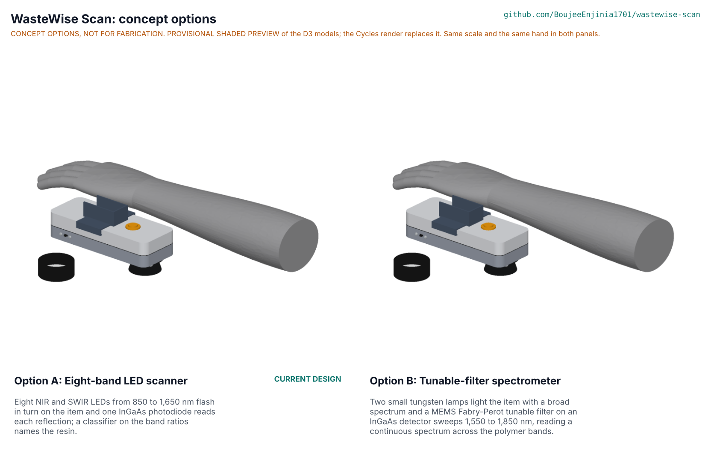

# WasteWise Scan concept options

Option A, the current eight-band LED scanner, scores 186 of 235 against 173 for option B, a tunable-filter spectrometer: A is ahead by 7.0 %, inside the 10 % band, so **both go to Amish without a pick** (STANDARDS section 21). A is cheaper, faster and tougher; B reads a continuous spectrum across the 1,650 to 1,765 nm polymer bands that A only reaches at their short edge, which is where PE against PP is at risk (PR-001). The repo keeps the current design as option A, as the standard requires for a design that predates kit 1.8; nothing is redesigned without Amish's go. Method: STANDARDS section 21. Selection record: WSC-DDR-005.

*Figure 1. The two options, each a D3 model from `cad/src/model.py` (`components("A")`, `components("B")`), drawn at one scale with a hand for scale. The picture is rendered with `python .kit/options.py` in Blender Cycles; until then the file is a labelled shaded preview.*

## The options

### Option A: eight-band LED scanner (current design)

Eight NIR and SWIR LEDs from 850 to 1,650 nm flash in turn on the item and one InGaAs photodiode reads each reflection; a classifier on the band ratios names the resin. This is the constructable design of WSC-DDR-004 with fixes F1 to F3 (baffle through the glass, four-cycle scan, larger cell strap; WSC-DEC-001). Each band is read between two dark readings, four times over; clear items in sun are backed with the black calibration cap. First-order numbers from WSC-CAL-001: 0.64 s per scan, signal-to-noise ratio of 640 or more in shade, 21.9 h per charge, 239 g (259 g with the cap), USD 167.50 in parts. Key risks: PE against PP (the 1,650 nm band is clipped by the detector cutoff; paper band study 93 % for that pair, 89.5 % for all five resins at 1.5 % item scatter), display legibility in direct sun, and SWIR LED prices. From a co-design partner it needs a labelled set of local items (200 or more) and the local price grades.

### Option B: tunable-filter spectrometer

Two small tungsten lamps light the item with a broad spectrum, and a MEMS Fabry-Perot tunable filter on an InGaAs detector, in one TO-5 class can, sweeps 1,550 to 1,850 nm and reads a continuous spectrum (Hamamatsu C13272 series range, cited in the sources). It shares A's body, shroud, split window, display board, cell and cap; only the optical head changes: a taller head block holds the sensor in its centre bore and the two lamps on the body axis, tilted about 28° in aluminium sleeves (fix F4) so their light meets on the item, and a driver board above it carries the filter's tuning supply, the amplifier and the converter. First-order numbers (WSC-STM-001 S30 to S36, estimates): about 0.74 s per scan for a 100-point sweep (before any repeat cycles for sunlight like option A's), signal-to-noise ratio well above 200 per 20 nm step, 19.3 h per charge, about 242 g (262 g with the cap), and at least USD 375 in parts. Key risks: the sensor price (INR 26,640 excluding taxes for one sensor on IndiaMART, about USD 300 at an assumed INR 88 per USD), lamp glass heat next to a PETG head block, filament life in drops, the filter's settling time and its voltage-to-wavelength calibration, and the loss of the 1,200 nm and 1,400 nm bands that help with PET and PVC. From a co-design partner it needs the same labelled item set, and a supplier who can sell single sensors in India.

## First-order numbers

Table 1. Options compared.

| Quantity | Option A | Option B |
| --- | --- | --- |
| Estimated parts cost (USD) | 167.50 (priced BOM, WSC-CAL-001 K2) | At least 375 (A's BOM less USD 92 of LEDs and photodiode, plus about USD 300 for the sensor; lamps and filter driver to assess) |
| Mass (g) | 239; 259 with the cap (WSC-CAL-001 A3) | About 242; 262 with the cap (estimate: head block 5 g heavier, optics 2 g lighter, sleeves about 1 g) |
| Output or throughput | 0.64 s per scan, 8 bands, four cycles (E2) | About 0.74 s per scan, about 100 points from 1,550 to 1,850 nm (S33) |
| Energy or effort | 0.40 W average, 21.9 h per charge (F2) | About 0.45 W average, 19.3 h per charge (S35) |
| Parts count (D3 model, `cad/fidelity.json`) | 86 parts: 48 made or bought, 38 fasteners | 78 parts: 40 made or bought, 38 fasteners |
| Mass in the D3 model (kit densities, summed from `components()`) | 218.8 g | 220.5 g |
| STEM check | No failed row after fixes F1 to F3; 11 of 23 rows plausible | No failed row after fix F4; 3 of 7 rows plausible |

The model masses use the kit's material densities, which have no PETG, TPU or PTFE (HDPE stands in), and leave out wire and solder; the calculation note's 239 g is the design figure.

## Scoring

Table 2. Weighted scoring (weights: High UR 3, Medium 2, Low 1; scores 1 to 5).

| Criterion | Source | Weight | A | B | Reason |
| --- | --- | --- | --- | --- | --- |
| Right resin | UR-001 | 3 | 3 | 4 | B covers the PE and PP first-overtone bands fully; A reaches their short edge (93 % on paper for PE against PP); B loses the 1,200 nm band |
| Quick | UR-002 | 3 | 4 | 4 | 0.64 s against about 0.74 s, both well under 1.5 s |
| Honest unknown | UR-003 | 3 | 4 | 4 | Same confidence rule and black threshold |
| Works in the sun | UR-004 | 3 | 4 | 4 | Both need the backing step for clear items; sunlight still outweighs either source in a 20 nm slice |
| Lasts a shift | UR-005 | 3 | 5 | 4 | 21.9 h against 19.3 h |
| One hand, light | UR-006 | 3 | 3 | 3 | Both about 9 to 12 g over 250 g with the cap |
| No reading needed | UR-007 | 3 | 3 | 3 | Same display and sun hood |
| Our price grade | UR-008 | 3 | 5 | 5 | Same firmware feature |
| A record of scans | UR-009 | 2 | 5 | 4 | B's spectrum record is larger (about 100 points), fewer scans per partition, still far over 10,000 |
| Survives handling | UR-010 | 3 | 4 | 3 | Solid-state LEDs against tungsten filaments and a MEMS filter in a 1,200 g corner drop |
| Easy to keep right | UR-011 | 2 | 4 | 3 | B adds lamp colour drift with cell voltage and a wavelength calibration of the filter |
| Affordable to a cooperative | UR-012 | 3 | 3 | 1 | USD 167.50 (12 % over the target) against at least USD 375 (2.5 times) |
| Works with the phone app | UR-013 | 2 | 4 | 4 | Same shared record |
| Safe invisible light | UR-014 | 3 | 4 | 5 | A needs a hardware on-time limit on invisible LEDs; B's lamps glow visibly and are far below the limits |
| Safe battery | UR-015 | 3 | 4 | 4 | Same cell, cradle and strap; B draws a higher peak current |
| Built locally | UR-016 | 2 | 4 | 3 | B needs a tuning supply of tens of volts and a calibrated filter driver |
| Our data, our consent | UR-017 | 2 | 5 | 5 | Same record and consent terms |
| Maintenance | | 1 | 4 | 3 | Lamps wear out and need replacing; LEDs outlast the device |
| **Weighted total (of 235)** | | | **186** | **173** | A ahead by 7.0 %: inside 10 %, so no pick |

Cost against the value-engineering target, buildability and safety are scored through UR-012, UR-016, UR-014 and UR-015.

## Recommendation

No pick: the two options are within 10 %, so both go to Amish as **"Proposed, awaiting Amish"** (WSC-DEC-001, open decision 2; WSC-DDR-005). The repo keeps option A as its design until Amish decides, as the standard requires, and `concept_chosen` stays unset in `project.yaml`.

What each choice means:

- **Choose A** (the current design): no change to the repo; R1's PE and PP risk is settled by the first labelled item set at TRL 4. The runner-up's best idea to graft onto A is B's reach into the 1,700 to 1,750 nm band, as a ninth LED band with an extended InGaAs photodiode, which is the open decision 1 already in WSC-DEC-001.
- **Choose B**: the optical head, its board, the BOM, the build plan and the CAL change; the value-engineering target would be missed by at least USD 225, and the sensor would need a confirmed single-unit supplier. The best idea to keep from A is its 1,200 nm band, as one LED beside the lamps, for PET and PVC.

## Sources

- Hamamatsu C13272 series MEMS-FPI spectrum sensor, 1,550 to 1,850 nm, tunable filter and InGaAs PIN photodiode in one package: Photonics Online, https://www.photonicsonline.com/doc/ultra-small-mems-fpi-spectrum-sensor-c-datasheet-0001; Photonics.com, https://www.photonics.com/Product.aspx?PRID=61532 (TO-5 can). Both checked 2026-10-25.
- IndiaMART listing, Hamamatsu C13272-02 MEMS-FPI spectrum sensor, INR 26,640 per piece excluding taxes, range given there as 1,550 to 1,850 nm. https://m.indiamart.com/proddetail/mems-fpi-spectrum-sensor-23949601312.html. Checked 2026-10-25. The exchange rate of about INR 88 per USD is assumed, to confirm when bought; the exact type number and its range are to confirm with Hamamatsu before any purchase (to assess).
- WasteWise Scan calculation note WSC-CAL-001 v0.5 and STEM check WSC-STM-001 v0.1 for every other number.
